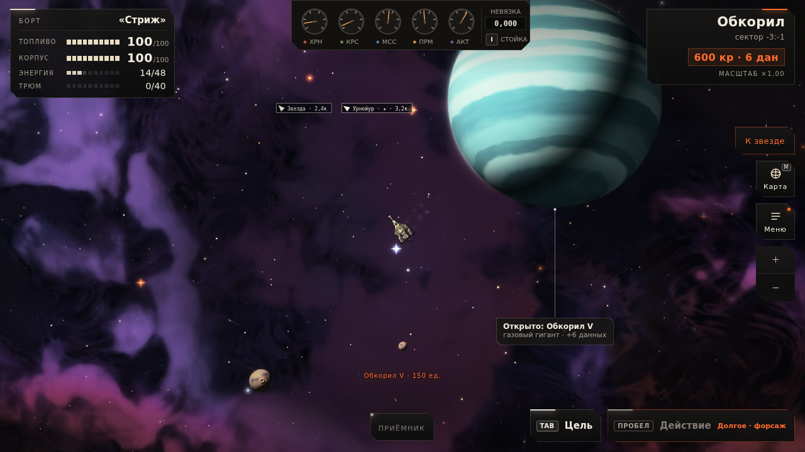
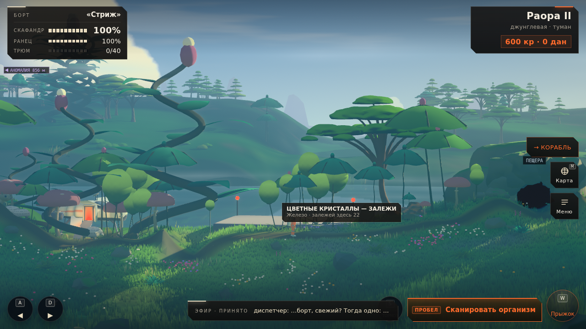
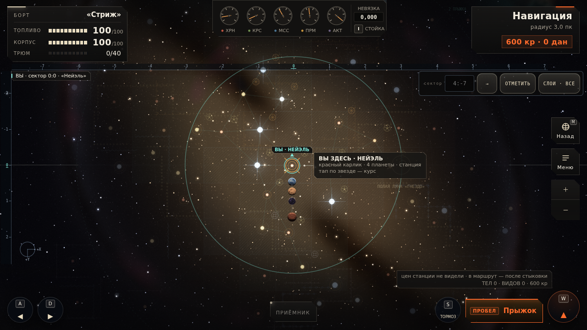
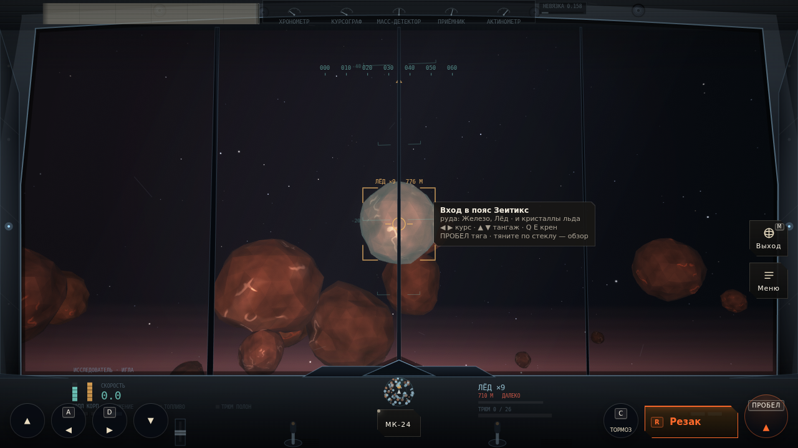
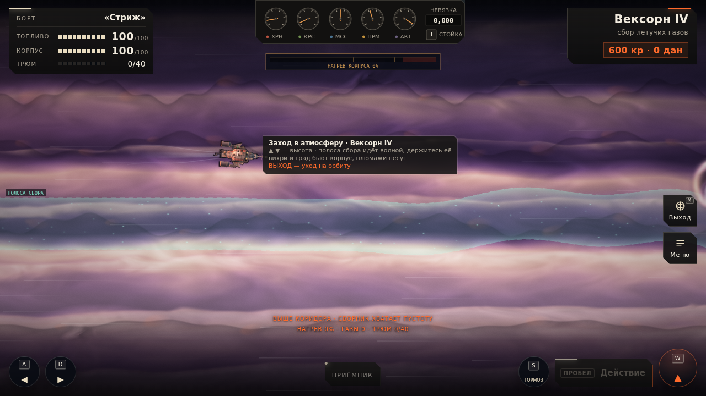
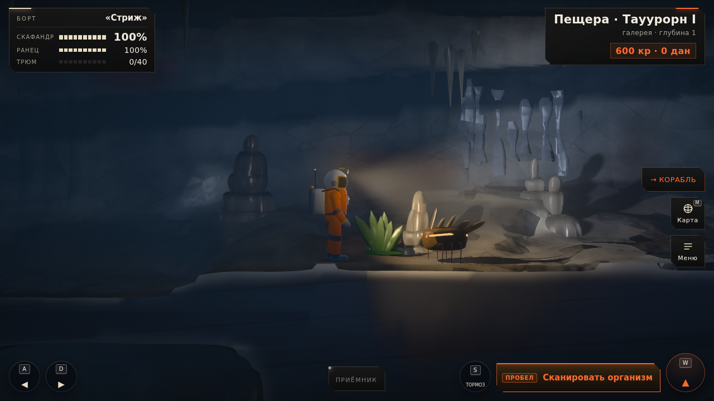
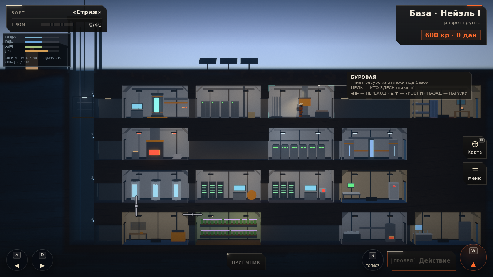
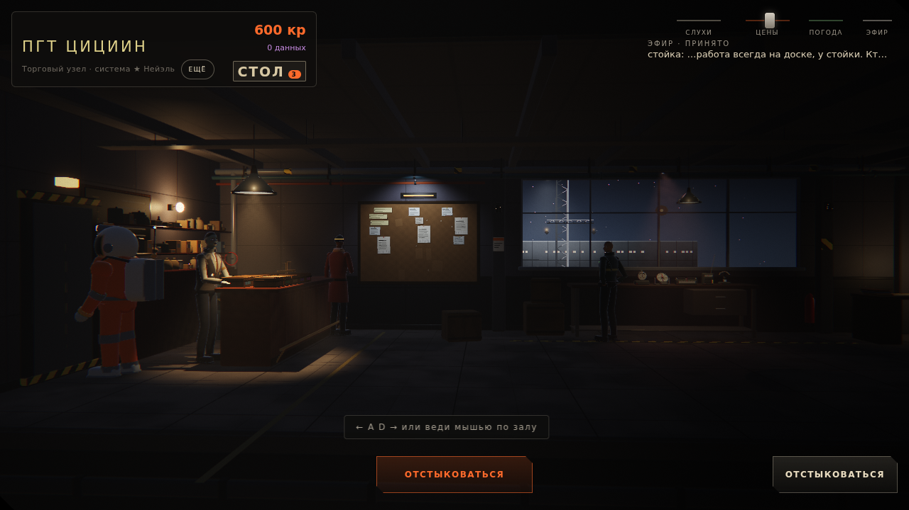
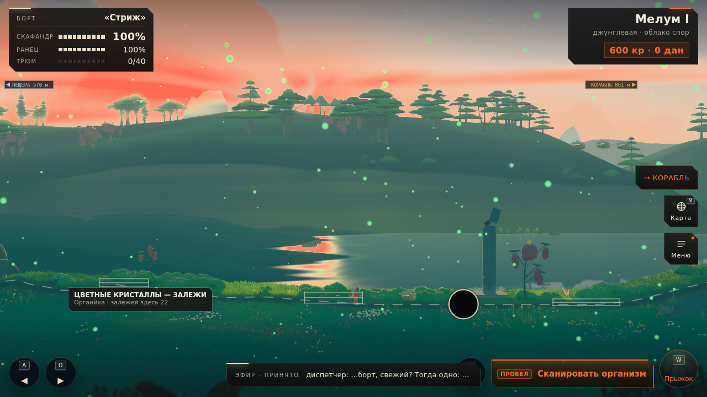

<div align="center">

# Дрейф · Drift

**A procedural space game in a single HTML file — in alpha.**

One pilot, one small survey ship, and a galaxy computed from seeds. No install, no dependencies,
no server, no asset files: every ship, planet, station and face is generated at runtime, and every
sound is synthesised. The world — planets, ships, stations and interiors — is drawn in 3D on the
GPU. The interface is in Russian.



[**Play in your browser →**](https://drift-game.ru) · [Download `drift.html`](drift.html) ·
[Report a bug](https://github.com/DrEgoroff-drift/drift/issues)

</div>

You start with half a tank of fuel and no particular destiny. Fly to other stars, land on the
planets you find, walk their surfaces in a suit, dig, skim gas giants, trade, build a base, hire
people who keep working while you are away, and push back against pirates taking systems one by
one. Or ignore all of that and just look at the sky.

[Play](#play-now) · [Alpha status](#alpha-status) · [Screenshots](#screenshots) ·
[What you can do](#what-you-can-do-in-the-alpha) · [Build it](#build-and-run-it-locally) ·
[Report a bug](#feedback-and-bugs)

## Play now

- **In the browser:** [drift-game.ru](https://drift-game.ru). Free, nothing to install, no
  registration. An account is optional and only carries saves between devices.
- **Offline:** download [`drift.html`](drift.html) and open it. That one file is the whole game —
  no server, no build step, saves in local storage. It can also be installed as an app (PWA) from
  the site.
- **How to play:** [drift-game.ru/mechanics.html](https://drift-game.ru/mechanics.html) explains
  flying, fuel, landing, money, crew and saves in plain Russian.
- **What it needs:** a browser with WebGPU — current Chrome, Edge, Yandex Browser or Opera on
  desktop and Android, or Safari 26 / iOS 26 and newer. There is no 2D fallback: without WebGPU
  the game says which browsers it needs instead of drawing a world.
- **Controls:** keyboard and mouse on desktop; touch controls appear on phones and tablets. Keys
  can be rebound in the options, and the first launch introduces the basics.

## Alpha status

**Drift is in alpha.** The core game is built and playable end to end. The work now is **fixing
bugs and tuning the economy**, not adding a planned feature queue — the old development plan is
closed and kept only as history in [`PLAN.md`](PLAN.md).

- This is **not a stable, bug-free release**. Expect rough edges, unfinished corners and bugs.
  Please report them.
- **Economy numbers are being balanced.** Prices, payouts, wages, yields and payback times can
  change between builds while the numbers are tuned.
- **Phones run the game** with touch controls, but the final phone performance and usability pass
  is still ahead. Desktop is the more tested experience today.
- **Saves keep loading.** The save format writes `v5` and still reads `v4`; features added since an
  old save was written get safe defaults, so an old game does not break.

The build number is shown on the title screen. Every change and fix is listed in
[`PATCHNOTES.md`](PATCHNOTES.md).

## Screenshots

Nothing below is a mockup or a concept. These are real 3D frames from the current build, captured
headlessly from the game itself with [`docs/mkshots.ps1`](docs/mkshots.ps1): the same WebGPU
renderer, the same generated world and the same interface a player sees. The frames are 1280×720
and show the desktop interface; on a phone the layout and touch controls are different.

<table>
<tr>
<td width="50%" valign="top">

<b>On foot.</b> Planets are places, not windows: terrain, weather, day and night, flora and fauna
all come from the seed. Walk, prospect, mine deposits, scan life, or just follow the horizon.
</td>
<td width="50%" valign="top">

<b>The galaxy map.</b> Every star has an address and every rumour can be laid in as a course.
Rulers, the address field, the reach circle and the sector card are part of the chart, not a menu
on top of it.
</td>
</tr>
<tr>
<td width="50%" valign="top">

<b>Asteroid belts.</b> A 3D flight mode flown from a generated cockpit: pitch, yaw and roll with
inertia, a horizon that banks into turns, and rocks that break into drifting debris as you mine
or shoot them. The cockpit follows the hull class you fly.
</td>
<td width="50%" valign="top">

<b>Skimming a gas giant.</b> Volatiles come from a narrow altitude corridor: above it the scoop
takes nothing, below it hull heat climbs. Bands, fronts and turbulence belong to the planet.
</td>
</tr>
<tr>
<td width="50%" valign="top">

<b>Caves and mines.</b> Some worlds hide a walkable cave mouth; a mine can be sunk into bare
ground and tunnelled through three depth tiers. Your suit lamp is the only light unless the flora
glows, and deeper rock is richer rock.
</td>
<td width="50%" valign="top">

<b>A base you dig into a world.</b> The cross-section is the game: cut rock, place modules, keep
power above demand, mind what sits next to what, post crew, and rebuild after a raid. Each kind
of room has its own interior and its own work going on.
</td>
</tr>
<tr>
<td width="50%" valign="top">

<b>The station hall.</b> A real 3D room you walk through: the bar, the notice board, the window on
the dock and generated people with their own faces. Managers are hired here; deals, rumours and
passengers start at the tables.
</td>
<td width="50%" valign="top">

<b>A region with its own law.</b> The galaxy's edges each bend the sky their own way; here the sun
sits on the horizon and the air is full of drifting light. Eclipses, parades and three-sun
convergences come from the calendar, not from a dice roll.
</td>
</tr>
</table>

---

## What you can do in the alpha

### Fly

- **Autopilot** — tap an object to approach, close in and dock. It aims at an intercept point, so
  it converges instead of chasing an orbiting body; near a planet it captures a stable co-rotating
  orbit and holds it until you throttle, brake or turn.
- **Manual control** — thrust, a brake that kills velocity outright, and turning with angular
  inertia, so the ship carves an arc and banks into it.
- **A branching star map** — systems with lanes and generated flavour text; planets move on
  elliptical Keplerian orbits, and every body stays catchable in the starter ship.
- **Gravitic anchor** — drift too far from the star and a gentle pull and an on-screen compass
  bring you back. A one-tap "to star" autopilot works from anywhere.
- **No dead save** — out of fuel with no way to refuel, you can pay for evacuation; without the
  credits you wake up at home with a ship from the garage, minus cargo and half your credits.

### Land, walk, dig

- **Twelve world types** — terran, ocean, desert, rocky, ice, volcanic, toxic, crystal, jungle,
  metal, ruin and gas giant — and most planets are a blend of two. The blend drives palette,
  relief, gravity, sky, weather, ore and the name; air never blends, it is breathable or it is not.
- **The ground is a material.** Each planet bakes one seamless tile with three scales at once,
  and each land biome has its own family of large forms, so a world reads by its silhouette.
- **Weather and light know the hour.** A day-night key feeds sky, ambient fill, shadows and the
  final grade; airless worlds keep a black sky at any hour. Storms are capped per world type, so a
  crystal planet is never washed flat white by fog.
- **Landing is flown, not clicked.** You fly the lander against real gravity and pay for a rough
  touchdown; the flight view and the lander's side-on silhouette are two different pictures.
- **Prospecting, mines and caves.** Walk generated terrain, mine visible deposits, scan flora and
  fauna, sink a mine through three depth tiers (2× and 4× richer, gated by drilling tech, suit wear
  and cave-ins), or find a cave mouth and follow it with your suit lamp.
- **Return beacon** — researched tech that teleports you back to your lander from anywhere on the
  planet, on a cooldown.

### Mine, skim, salvage

- **Asteroid belts** — a 3D cockpit mode with pitch, yaw and roll; rocks break into drifting debris.
- **Gas skimming** — a narrow altitude corridor above a gas giant; hull heat and turbulence push
  you out while the scoop fills.
- **Rare materials** — four materials the market refuses, each with one source:

  | Material | Source |
  |---|---|
  | Volatiles | atmospheric skimming on gas giants |
  | Ice crystals | belts on distant, cold orbits only |
  | Alloys | smelted from ore at industrial stations or a base refinery |
  | Tech components | boarding a pirate base, and nowhere else |

  They are spent on the laboratory, base construction and hull fusion, so they stay goals rather
  than expensive cargo.

### Trade, work, economy

- **A living market.** Every station's prices sag when you dump cargo there and recover over time,
  so where you sell matters; station type shifts prices on top of that. Seven station types —
  trade hub, industrial, shipyard, science, frontier outpost, fuel depot and bazaar — decide which
  tabs exist and what the place is good for.
- **The cooperative counter.** Goods are not for sale to a private pilot until you register a
  cooperative: an exam by turnover, a fee, a name and a patron house. Three ranks set how much a
  visit may take, how many hands you may hire and how tight the spread is; the price runs in
  slices of ten. A bazaar's flea market sells used goods with a provenance, quoted in house scrip.
- **Orders and needs.** Stations post work at the counter: short deliveries, standing needs,
  passengers and business of their own. The journal keeps what you took, from whom, the deadline
  and what was promised; every line with an address lays a course on the map.
- **Drones and the drone-miner.** Buy a drone, drop it on a deposit or asteroid, fly away: it
  works on the lazy clock, hauls to the nearest station and sells at live prices. The drone-miner
  works a deposit round the clock and is priced by payback.
- **Matches and «Сорока».** Under the cowl of every salvaged part sits a handful of matches.
  Credits never buy them and the market never takes them; the wandering sail-ship «Сорока» is the
  one place to spend them, on tools, cosmetics and a barter lot per stop.
- **A ship's log** records kills, drone deliveries, sales, research, discoveries, crew reports,
  base raids and wrecks, and persists with the save.

### Ships, parts, research

- **A hundred hulls in six tiers** — eight hand-built ships plus a deterministic catalogue of
  ninety-two, from workhorses to legends counted in single units. A dock stocks a slice keyed to
  its seed and a time bucket, not the whole list; a cheap hull is always available so you cannot
  be stranded, and a shipyard can build a one-off unique hull.
- **Modules, parts and rigging.** Seven upgrade tracks with four levels each; parts in six
  categories with affixes, and the strong ones carry a real drawback. Every hull has a rigging
  budget that modules and parts both draw from, so you cannot run everything at once.
- **A thousand artifact nodes and ten crowns** — completing a family forges a crown, an effect
  obtainable no other way. Nodes only drop from pirates, deep shafts and boarding actions.
- **The laboratory** — fuse two ships plus rare material into a third, or craft parts at three
  tiers. Stats blend toward the stronger parent, and both originals are consumed.
- **The ОПИСЬ table.** One cloth with four zones — what you wear, what is fitted, what you carry,
  the hatch — plus the matchbox shelf. Fitting happens on the hull silhouette, and the ПРИБОРЫ
  panels show what a part would do before you commit.
- **Research** — a tech tree paid for with survey data, including repeatable tracks that keep
  scaling.

### Crew and managers

- **Mercenaries are generated people** — name, specialty, traits that act as multipliers and
  thresholds; a veteran costs more and comes back, the careful one brings less, the greedy one
  skims the hold, the stubborn one ignores your first order.
- **Orders** — hunt pirates, mine, run a route, work a base or idle. They resolve from elapsed
  time, capped at eight hours offline; nothing flies around in the background. Wages are drawn on
  the same clock, and debt, morale, desertion and a lost ship are all possible and all visible
  before the last step lands.
- **Meet them in space** — fly into a sector where your crew works and they appear as real ships
  alongside you, built on the pirate NPC frame and shooting at pirates.
- **Managers take a whole domain** — the crew wing, drones and bases, a trade route, or the
  laboratory. There are exactly four seats. Each takes a visible cut before the money reaches you;
  loyalty slides with missed payroll, and at zero a manager defects and flies against you with
  your own flagship and perks. Beating them does not kill them: they come back as exiles.
- **Every perk is wired to something.** The whole manager tree is visible from the start, and a
  test fails if any perk id in it is not read by the game. Seven artifacts from the laboratory,
  one worn per manager.

### A place of your own

- **The home is not for sale.** It appears after your first honest sale and grows through eight
  tiers out of accumulated turnover. The tiers do things — an extra standing-order slot, faster
  morale recovery, a showcase that turns displayed rare material into reputation. Death is not a
  wipe: you come back home with a ship from the garage.
- **The home is a house you walk into**, not a panel: eight rooms, each with its own floor,
  lamplight, things to stand next to, and people who actually live there.
- **The base** is a grid cut into a planet: reactor, solar array, drill, storage, habitat,
  refinery, landing pad. Power is the constraint, adjacency matters, crew can be posted to four
  roles, and pirates come for the store more often the deeper into dangerous space you build.
- **The holding** lets you land a build of your own on someone else's station — a route bought as
  an order rather than priced. Eighty-two buildings across nine families grow against the
  station's real appetite; a rank ladder opens reach, your own barge works the route, and what you
  build is never for sale.

### The galaxy moves

- **A war you are not the centre of.** Pirates occupy systems from a source and spread outward;
  occupation takes services away, and you take a system back by playing in it — kills count per
  system, hitting the quota drops the level and turns the station back on.
- **Boarding pirate bases.** Dangerous sectors hold stations you can board on foot: corridors
  projected from the belt's own polygons, finite ammunition, four enemy types, mezzanines and a
  hangar to reach with the loot.
- **The fleet you can't buy.** **ГЛАВТРАССА** runs thirteen classes of state ships on its own
  schedule along the long lines. Hail one and it answers in its class's own voice; you can be
  towed, refuelled, convoyed, or called to a barge in distress.
- **Danger is optional.** Pirates are absent near home and increasingly common the further out
  you push. Fighting has its own gun module and bounty tech, but outrunning or jumping away is
  always valid; bases, boarding and mercenary hunts are opt-in layers on top.
- **A hundred short stories** live in cantinas and along the routes: debts bought at a third of
  face value, pilots vouched for, crates taken with no explanation, bets backed, maps bought off a
  geologist. Answers with a tail become journal entries with an address and a deadline.
- **A century of rarities** at fixed addresses, the map's addresses and holdings layers, and
  «Смена» — the author's novel bound on the desk, which opens a chapter only once you have lived
  the mechanic it is about.
- **The road companion** on a phone turns a real trip into flight: GPS speed becomes cosmic, the
  accelerometer banks the hull through real turns, and the microphone colours the nebulae. Other
  pilots riding the same cell appear as distant companion lights.

## Economy and balance

The economy is live, not a shop with fixed prices. Selling pushes a station's price down and it
recovers over time; station type and the spread between neighbours decide whether a route is worth
flying. Drones and the drone-miner pay back over real hours, a hired hand is a bet rather than a
steady income, and a manager's cut is always shown as a line. Rare materials are deliberately
outside the market so they cannot inflate prices.

This is the part being tuned in alpha: measurements are current, not promises, and the numbers can
move between builds. If a route or a payout looks wrong, that is useful feedback — please open an
issue with what you did and what you expected.

## Under the hood

- **A world from seeds.** Systems, orbits, belts, stations, pirate bases, base geology, planet
  relief, plants and creatures are regenerated from a seed when needed; only what you changed is
  saved.
- **Everything is drawn on the GPU.** Since 0.457.0 the renderer is WebGPU: the nebula and its
  drifting dust, HDR light with a soft bloom, hulls lit from the star's side, particles, and the
  instruments on a sharp layer of their own. The 2D-style drawing is a GPU canvas too — there is no
  Skia raster of the world and no 2D fallback.
- **Every sound is synthesised.** There is no audio file in the project: oscillators, filtered
  noise and envelopes make the engine, guns, hits, the drill, footsteps and warnings, and the
  music is generative — six layers drifting in and out, with each place picking its own mode and
  tempo from its seed.
- **Saves are portable.** Local autosave, base64 save codes for moving between devices, and
  optional cloud sync. The format writes `v5` and reads `v4`; seeds are never stored, only your
  decisions and what you carried home.

## Build and run it locally

You do not need any of this to play — the browser version and `drift.html` are enough. To work on
the game, edit files under [`src/`](src) and rebuild:

```bash
# Windows
powershell -ExecutionPolicy Bypass -File build.ps1

# Linux / macOS (PowerShell 7)
pwsh ./build.ps1
```

`-Watch` rebuilds on save. The build produces `drift.html`, `tests.html` and the generated
[`docs/INDEX.md`](docs/INDEX.md) address book; `drift.html` is a build artifact and editing it by
hand is overwritten by the next build.

The whole game shares one scope, and modules are concatenated in filename order — constants and
tables must be declared before anything reads them. A new module gets a new numeric prefix in the
right place; fractional steps (`19a-`) avoid renaming neighbours.

**Tests:** `test.ps1` runs the fast tier (build, Node suites, a Chrome smoke test and the vision)
in about fifteen seconds on a desktop, and `-Full` runs every suite including the heavy nets:

```bash
powershell -ExecutionPolicy Bypass -File test.ps1
powershell -ExecutionPolicy Bypass -File test.ps1 -Full
```

On Linux or macOS use `pwsh ./test.ps1`. The suites drive the real game state through
`resetWorld()` and mock nothing. `node test-node.js` runs only the Node tier; `-Only` narrows a
run to a suite name, `-NoBuild` skips the build and `-Browser` adds the Chrome-only suites.

## Project structure

| File | Purpose |
|---|---|
| [`drift.html`](drift.html) | The entire game in one self-contained file — open it to play. **Built from `src/`; do not edit by hand.** |
| [`src/`](src) | Sources: the HTML shell, `style.css` and about 570 JavaScript modules (core maths and RNG, galaxy, planets, ships, parts, the WebGPU renderer, audio, music, economy, crew, save, one per game mode, UI). Concatenated in filename order, because it all shares one scope. |
| [`tests/`](tests) | Hundreds of suites by topic, plus the cross-cutting nets: a fuzzer, game QA, physics at every frame step, isolation, the frame meter. They drive the real game through `resetWorld()` and mock nothing. |
| [`build.ps1`](build.ps1) | Rebuilds `drift.html` from `src/`. PowerShell, no dependencies; `-Watch` rebuilds on save. |
| [`test.ps1`](test.ps1) | Runs the suites, the smoke test and the vision headlessly, in tiers (`-Full`, `-Browser`, `-Mobile`, `-Only`, `-NoBuild`). |
| [`site/`](site) | The [drift-game.ru](https://drift-game.ru) pages: front page, how to play, the war map, the test lab, accounts and cloud saves (`api.php`), and the flat and 3D birds. Published on a push to `main`. |
| [`bird/`](bird) | Sources of the 3D bird (WebGL2, `bird.ps1` builds them into one file). Not part of the game. |
| [`docs/shots/`](docs/shots) | The real game frames used in this README, and the comparison sheets behind the design log. |
| [`docs/INDEX.md`](docs/INDEX.md) | Generated address book of the sources: every top-level symbol as `file:line`. Grep it, do not read it whole. |
| [`CLAUDE.md`](CLAUDE.md) | House rules for working on the code: what lives where, what must not change, how to verify. |
| [`PLAN.md`](PLAN.md) | The old development plan, **archived 31.10.2026**. There is no active roadmap; kept as history. |
| [`docs/DECISIONS.md`](docs/DECISIONS.md) | The rules and the author's decisions that stand across all the work. |
| [`docs/done/`](docs/done/README.md) | Design log — every finished milestone, what it solved and why it was built that way. |
| [`PATCHNOTES.md`](PATCHNOTES.md) | One entry per build: what changed and what it fixed. |

## Feedback and bugs

The alpha is deliberately public, and bug reports are the most useful thing you can send.

1. Check the [open issues](https://github.com/DrEgoroff-drift/drift/issues) — the bug may already
   be known, and a note that it still happens helps.
2. Open a [new issue](https://github.com/DrEgoroff-drift/drift/issues/new). Include the build
   number from the title screen, browser and OS, what you did, what happened, and what you
   expected. A screenshot or a save code makes a hard bug much easier to reproduce.
3. Write in Russian or English, whichever is easier.

GitHub Issues is the place for bug reports, ideas, questions and "this confused me".

## History

The game has grown over hundreds of versions, and the story of each one is in
[`PATCHNOTES.md`](PATCHNOTES.md); the design log in [`docs/done/`](docs/done/README.md) explains
why the larger systems are the way they are. The development plan that led to the alpha is closed
and archived in [`PLAN.md`](PLAN.md) — it is a record, not a queue. From here the work is bug
fixes, economy balance and the polish the alpha turns up.
