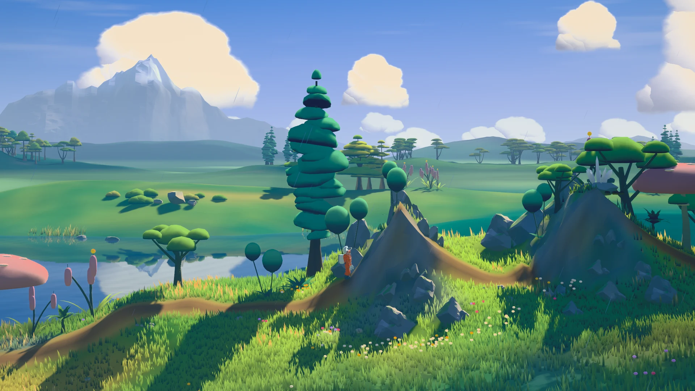
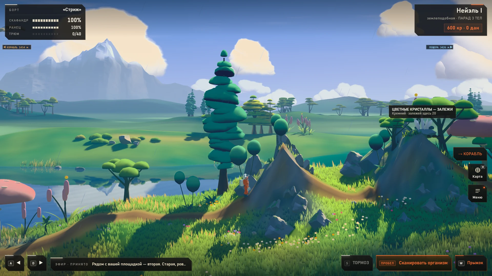
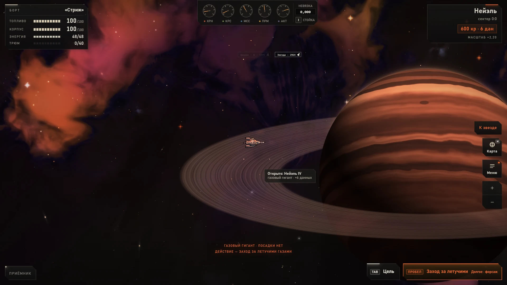
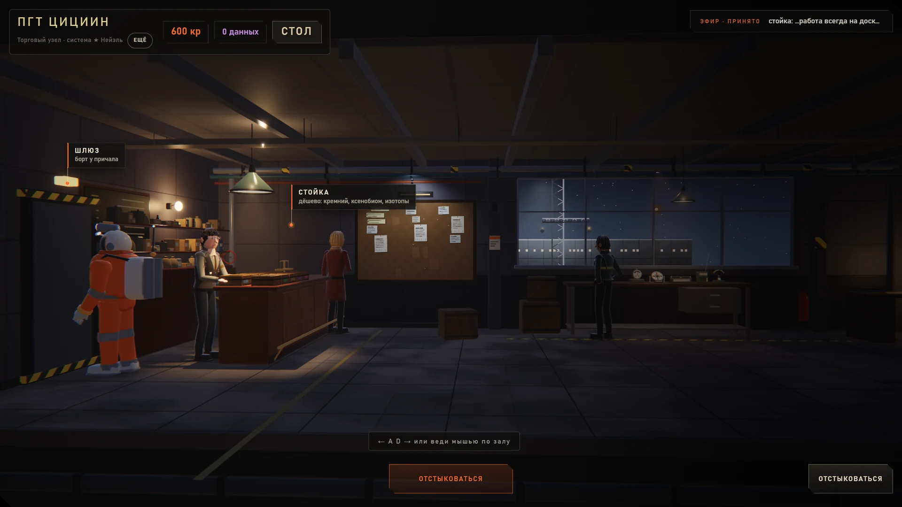
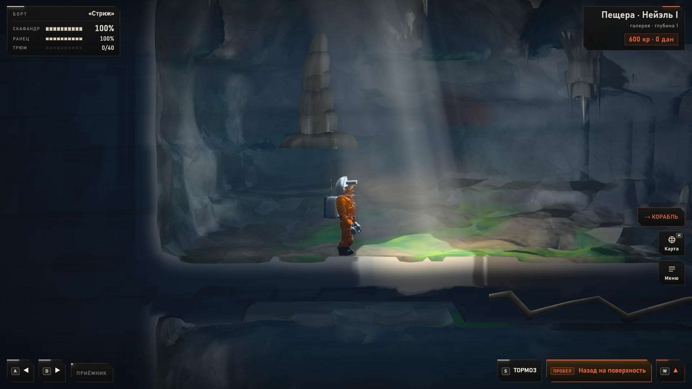
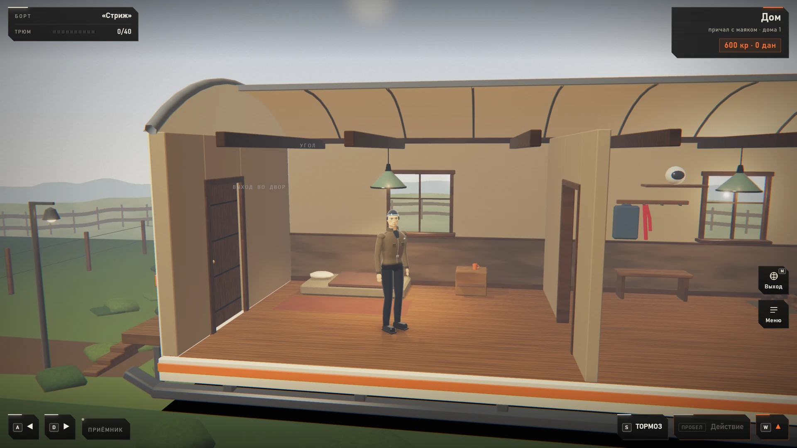
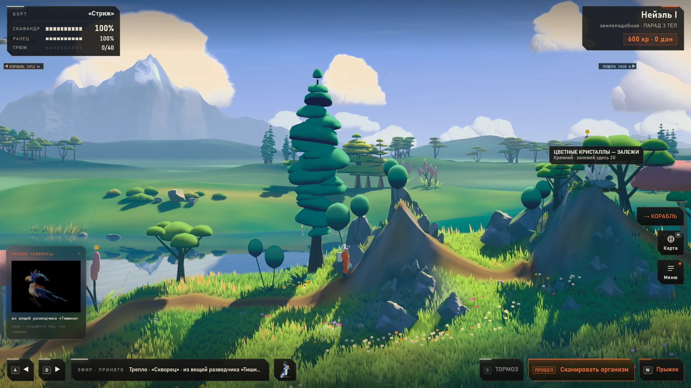

<div align="center">

# ДРЕЙФ · DRIFT

### A small ship. A strange galaxy. Your own way through it.

**OPEN ALPHA · PLAYING, TESTING, FIXING**

[**PLAY NOW ↗**](https://drift-game.ru/play.html) · [Alpha release & download](https://github.com/DrEgoroff-drift/drift/releases/tag/v0.499.106-alpha.1) · [Report a bug](https://github.com/DrEgoroff-drift/drift/issues/new)



**A free space exploration sandbox, directly in your browser.**

Fly between stars. Land on alien worlds. Leave the ship and explore on foot.Mine, trade, hire a crew, build a home — or just watch the sky.

</div>

## The alpha is here

The core game is built. This is a **playable alpha for public testing**, not a finished,
bug-free release. The old milestone plan is closed; current work is **bug fixes, economy
balance and the polish real play reveals**.

- **Play free, without registration.** An optional account carries saves between devices.
- **Russian in-game interface.** [How to play, in Russian](https://drift-game.ru/mechanics.html).
- **WebGPU required.** Use a browser/device that supports it; the game reports when it is unavailable.
- **Desktop and touch controls.** Desktop is currently better tested. A real-device phone performance pass is still needed.
- **One HTML file to play offline.** Download `drift.html` from the alpha release and open it in a compatible browser. Online features need a connection.

> **Help test the alpha.** Something flickers, a landing stalls, money behaves strangely,
> or the interface gets in your way? [Tell us what happened](https://github.com/DrEgoroff-drift/drift/issues/new).
> A screenshot, browser/device, build number and steps to repeat it are more useful than a perfect bug report.

## Actual game frames · build 0.499.106

Captured from the running game on 2 November 2026. No generated promotional art or mockups.
The cover hides the HUD for a clear view of the world; gameplay frames below retain the interface.
Click an image to open it at full size.

<table>
<tr>
<td width="50%"><a href="site/shots/alpha-surface-106.webp"></a><br><b>Step outside.</b> Walkable terrain, weather, living things and a sky that belongs to this world.</td>
<td width="50%"><a href="site/shots/alpha-system-106.webp"></a><br><b>Find the next horizon.</b> Fly a small ship through generated systems, approach planets and plan the next jump.</td>
</tr>
<tr>
<td><a href="site/shots/alpha-station-106.webp"></a><br><b>Come in from the cold.</b> Station halls, trading counters, people, jobs and rumours.</td>
<td><a href="site/shots/alpha-cave-106.webp"></a><br><b>Go below the surface.</b> Caves, deposits and the small circle of light from your suit.</td>
</tr>
<tr>
<td><a href="site/shots/alpha-home-106.webp"></a><br><b>Make a place your own.</b> Build, settle, keep a crew and come back to something familiar.</td>
<td><a href="site/shots/alpha-bird-106.webp"></a><br><b>Bring company.</b> A talkative bird, a radio and the stories that travel with you.</td>
</tr>
</table>

## What you can already do

| Explore | Make a living | Leave a mark |
| --- | --- | --- |
| Fly between star systems and land on planets | Mine deposits, asteroid belts and gas giants | Build bases and a home |
| Walk surfaces, enter caves and scan life | Trade cargo and fit out your ship | Hire crew and managers |
| Visit stations and follow rumours | Take jobs and deal with pirates | Watch factions act without waiting for you |

The world uses seeded generation, so places keep their identity. Ships, worlds and interiors
are rendered with WebGPU. Character geometry is embedded in the build; sound is synthesised.
There is no separate asset pack to install.

## What changed in this alpha build

- Station residents retain their individual faces and hair, with higher-detail head meshes on stable articulated bodies.
- Repaired the sleeve/waist deformation visible when people raised their arms or leaned at the counter.
- Corrected the pairing of cached room shadows and their light projection; station changes also invalidate that cache correctly.
- Planet preparation during system flight is included. **Some landing delays are still being investigated** — this is not a promise of instant landing in every situation.
- The README and website now use fresh frames from this build.

## Testing notes

**Economy:** prices, rewards, wages and payback times are still being tuned. Please report exploits and situations where the numbers stop making sense.

**Graphics:** report flickering or broken poses with a screenshot or short recording, your browser/device and where you were. A fix verified on one GPU does not prove every device is covered.

**Saves:** the game writes save format `v5` and reads `v4` and `v5`. Keep a backup of an important save while testing. An old save does not need to be deleted to update the game.

**Updating:** reload the browser version; if an old tab still shows the previous build, use Ctrl+F5. The title screen shows the build number.

## For contributors

The player only needs the browser version or the downloaded HTML file. For development:

```powershell
powershell -ExecutionPolicy Bypass -File build.ps1
powershell -ExecutionPolicy Bypass -File test.ps1
```

Edit `src/`, not the generated `drift.html`. The build concatenates the sources and updates
the source index. See [CLAUDE.md](CLAUDE.md) for project rules and [docs/VERIFY.md](docs/VERIFY.md)
for verification. [PATCHNOTES.md](PATCHNOTES.md) records the changes.

The [old plan](PLAN.md) is an archive, not an active roadmap. Current work follows bug reports,
playtesting and economy measurements.
