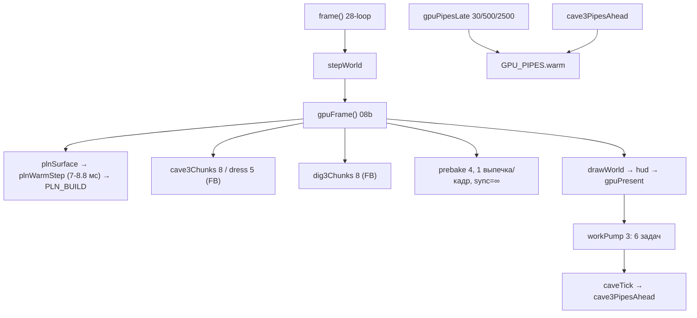

# Drift — Frame Pacing: полный отчёт (2026-11-01)

Ветка `engine`. Игровой код — как в `f2ee2ce` (сверено: `git diff f2ee2ce..HEAD -- src tests
build.ps1` пуст до диагностического патча; после патча менялись только точки замера). Всё, что
ниже, получено **на этой машине и этой версии**; где вывод сделан по коду, а не по измерению, это
сказано прямо.

Артефакты:
- `diagnostics/frame-pacing/REPORT.md` — этот файл;
- `diagnostics/frame-pacing/audit.md` — аудит систем подготовки (1-й этап);
- `diagnostics/frame-pacing/audit2.md` — 2-й этап (исправления, near-данные, патч);
- `diagnostics/frame-pacing/summary.md` — сводка trace/конфигураций;
- `diagnostics/frame-pacing/environment.json` — среда;
- `diagnostics/frame-pacing/near-run-01.json`, `near-run-02.json` — сырые кадры переходов;
- сырые Chrome traces — `%TEMP%\drift_trace.json` (374 МБ), `%TEMP%\drift_trace_noprobe.json`.

---

## 1. Итог (короткий)

1. **Композитор — не причина переходных скачков.** Переходные провалы приходятся на вызовы смены
   режима **вне кадра**: `startLanding()` — **0.85–0.96 с**, `enterSurface()` — **0.11–0.14 с**.
   Внутри кадра после них — 8.7 мс. Дисплей 240 Гц, `BeginFrame` — метроном (p99 4.28 мс).
2. **Steady-провалы композитора существуют отдельно:** `DrawFrame` 119/с, длинных (>16.7 мс)
   **12.1 %**, размазаны по 0–11 с. Это другой класс, чем переходы.
3. **Игровой JS в кадре лёгкий:** `FunctionCall` 0.54 мс/кадр в среднем, `FRAME_JS` max 9.5 мс в
   steady-сценах; `Graphics.Pipeline` (листья) p95 0.24 / p99 0.37 / max 0.9 мс.
4. **Подготовка ресурсов фрагментирована, но её вклад в переходные провалы не доказан:** бюджеты
   расходятся (см. §5), однако первый кадр спуска берёт 8–9 мс, а не 40; `prebake` в переходах 0.
5. **Реальные цели для исправления** (по измерению): `startLanding` ~0.9 с, `enterSurface` ~0.13 с,
   `drawWorld` 15 мс в шахте. Инструмент для их разбора готов (`?g11=near`).

---

## 2. Среда

| | |
|---|---|
| Chrome | **156.0.8078.76** (`HeadlessChrome/156.0.0.0`) |
| ОС | Windows NT 10.0.26200 (Windows 11) |
| Режим | `--headless=new`; отдельный прогон — окно Chrome |
| GPU backend | **ANGLE D3D11**, `directComposition: true` |
| Устройства | NVIDIA GeForce RTX 5070, AMD Radeon(TM) Graphics, Microsoft Basic Render Driver |
| featureStatus | `gpu_compositing: enabled`, `rasterization: enabled`, `webgpu: enabled`, `skia_graphite: disabled_off` |
| Дисплей (по trace) | **240 Гц** (`BeginFrame` p50 4.17 мс) |

Флаги базового прогона: `--headless=new --no-sandbox --window-size=1280,800
--force-device-scale-factor=2 --user-data-dir=<temp> --no-first-run --no-default-browser-check
--disable-background-timer-throttling --disable-renderer-backgrounding
--disable-backgrounding-occluded-windows`.

---

## 3. Что измерено

### 3.1. Четыре конфигурации (`?g11`, DPR 2)

| # | Конфигурация | rAF p50/p90 | max | long tasks |
|---|---|---:|---:|---:|
| 1 | headless | 4.2 / 4.2 | 37–58 | 1–4, max 102 мс |
| 2 | headless + `--disable-gpu-compositing` | 16.7 / 16.7 | ~50 | — |
| 3 | headless + `--enable-gpu` | 4.2 / 4.2 | 37–75 | 1–4, max 102 мс |
| 4 | **окно Chrome** | 4.2 / 4.2 | **29–58** | 2–4, max 96 мс |

`--disable-gpu-compositing` переводит композит на CPU; 60 Гц — свойство программного пути, **не**
«флаг ограничил FPS». `--enable-gpu` отличий не дал: GPU-композит и так включён.

### 3.2. Trace, steady-state (после +4 с загрузки)

| стадия | n | p50 | p90 | p99 | >16.7 мс |
|---|---:|---:|---:|---:|---:|
| `BeginFrame` (Compositor) | 3700 | 4.17 | 4.19 | 4.28 | 1 (0.0 %) |
| `ProxyMain::BeginMainFrame` (CrRendererMain) | 3563 | 4.16 | 4.31 | 8.76 | 7 (0.2 %) |
| `Commit` (CrRendererMain) | 3581 | 4.16 | 5.51 | 11.95 | 9 (0.3 %) |
| **`DrawFrame` (Compositor)** | 2200 | 4.21 | **16.64** | 19.28 | **204 (9.3 %)** |
| `Graphics.Pipeline` (листья, длительность) | — | 0.025 | 0.17 | **p95 0.24 / p99 0.37 / max 0.9** | 0 |

Полный прогон (без отсечения загрузки): длинных `DrawFrame` **292 / 2416 = 12.1 %**, и они
**размазаны по 0–11 с** (по 14–29 на секунду), а не сосредоточены на переходах.

Flame главного потока в окнах длинных кадров: `RunTask` 737.8 мс, из него `BeginMainFrame` 698.3 →
`FireAnimationFrame` 584.6 → **`FunctionCall` 571 мс на 1051 вызов = 0.54 мс/кадр**; `Commit` 44;
layout/paint 12–17; GC 3–4. То есть **главный поток занят ~17 %**.

### 3.3. Переходы (`?g11=near`, 240 кадров после смены `G.mode`, без пауз)

| Блок | prev | gap p50 | p90 | p99 | **max** | js max | >33 | >50 |
|---|---|---:|---:|---:|---:|---:|---:|---:|
| system | — | 4.2 | 4.2 | 4.3 | 4.4 | 0.6 | 0 | 0 |
| **landing (холодный)** | system | 4.2 | 8.4 | 12.5 | **854–962** | 35 | 1–2 | 1 |
| **surface** | landing | 4.2 | 4.3 | 8.4 | **108–137** | 139 | 1 | 1 |
| **dig** | surface | 4.2 | 4.3 | 16.7 | **33–42** | 43 | 1 | 0 |
| cave | dig | 4.2 | 4.2 | 8.3 | 8.3 | 10 | 0 | 0 |
| landing (тёплый) | cave | 4.2 | 8.4 | 12.4 | 12.5–16.7 | 18 | 0 | 0 |

Разбор худших кадров (второй прогон, `near-run-02.json`):

- `landing`, gap 962: `js` 8.8, `warm` 7.9, `drawWorld` 7.9 — **сам `startLanding`** вне кадра.
- `surface`, gap 137.5: `js` **8.7**, `sw` 0.8, `dw` 6.7, `hud` 0.7, `asave` 0, `vin` 0, `vout` 0
  — **сам `enterSurface()`**; 129 мс уходят в разрыв rAF.
- `dig`, gap 41.6: `js` 16.2, `dw` **15.1** — `drawWorld` в шахте.
- `cave`/тёплый `landing`: чисто.

---

## 4. Причины (по убыванию доказанности)

1. **`startLanding()` — 0.85–0.96 с** (переход `system → landing`). Измерено (`?g11=near`, gap).
   Доказано, что это вызов смены режима, а не кадр: внутри кадра после него — 8.8 мс.
2. **`enterSurface()` — 0.11–0.14 с** (переход `landing → surface`). Измерено; `js` внутри
   кадра 8.7 мс, остальное — в разрыве rAF.
3. **`drawWorld` 15 мс в шахте** (переход `surface → dig`). Измерено (`dw` 15.1).
4. **Steady-провалы композитора — 12.1 % `DrawFrame` >16.7 мс.** Измерено (trace). Не связано с
   переходами; причина внутри compositor/display — без отдельного trace не установлена.
5. **Фрагментация бюджетов подготовки (латентно).** По коду — да (см. §5); по измерению — вклад в
   переходы пока не виден (JS в кадре 8–9 мс), поэтому это P2/P3, не P0.

Опровергнуто: «все сцены крутят свои циклы»; «GPU виноват»; «`--disable-gpu-compositing` лечит»;
«`Graphics.Pipeline` p99 3.9 мс» (это был интервал между событиями, не длительность).

---

## 5. Аудит систем подготовки

### 5.1. Карта



| Система | Файл | Бюджет | В общем `FB`? |
|---|---|---|---|
| `workPump` | `17a0:54` | `WORK_MS=3`, `WORK_JS=10`, `WORK_LO=.5`, `WORK_STARVE=20` | да |
| `prebake` | `17a0:18` | `PB_MS=4`, `PB_PX=2^19`, `PB_CAP=64`, 1 выпечка/кадр | **нет** |
| `plnWarmStep` | `21pz:307` | `B=7` | **нет** (early return до `fbSpend`) |
| `PLN_BUILD` | `21pf:38` | 8 / **first 40** / frame 5 / low 1 | да |
| `CAVE3_CH` / `CAVE3_DR` | `22da:17`, `22dc:10` | 8 / 5 мс | да |
| `DIG3_CH` | `23ca:31` | 8 мс, hold 10 | да |
| `CAVE_PRE` | `22d:116` | 3 мс, wait 60 кадров | через `workPump` |
| `gpuPipesLate` | `08b0:114` | 30 / 500 / 2500 мс | нет (async) |
| `cave3PipesAhead` | `22d:122` | своя цепочка | нет (async) |

### 5.2. Фактический жизненный цикл `FB`

1. `fbBegin()` — начало кадра: `FB.base += (max(0, FRAME_JS − FB.spent) − FB.base)·0.1`, `FB.spent=0`.
2. `fbSpend()` в том же кадре: земля (`21pz:367`), пещера (`22d:328`), шахта (`23c:164`),
   `workPump` (`17a0:77`).
3. `plnWarmStep` и `prebake` **не вызывают `fbSpend`** — но их время входит в `FRAME_JS` и
   попадает в `FB.base` следующего кадра (сглаженно). Поэтому «14 мс не видит» — неверно: видит со
   задержкой в кадр.

### 5.3. `PLN_BUILD.first = 40`

`21pz:359`: `lim = L.first ? fbLeft(...) : B.first`. `L.first` стартует `false` → **первый кадр
спуска** получает `lim=40`, `cap=nFirst=6`. Дальше — общий бюджет ≤8. Замер: 8.8–9.4 мс, 40 не
выбираются. Совместно с `plnWarmStep` (7.9) идёт, `prebake` в этом блоке 0. Само по себе 33–79 мс
не даёт.

### 5.4. GPU compilation funnel

- Дедуп — **только кэш** `GPU_PIPES.warm`.
- Синхронная компиляция одна: `08b0:29` `d.createRenderPipeline(mk())`.
- `gpuPipesWarm`/`gpuPipesLate`/`cave3PipesAhead` — `createRenderPipelineAsync`.
- **Мьютекса нет:** один ключ дважды не строится (`22d:131`), но **разные ключи двух цепочек
  могут компилироваться одновременно**.
- Смена `G.mode`: только пересчёт темпа (`gpuLateGap()`), отмены нет; смена устройства — выход по
  `GPU_PIPES.dev !== d`.

### 5.5. Синхронные блокировки

| Место | Что | Потолок |
|---|---|---|
| `17a0:32` | `while(sync\|\|…)` — генератор до `r.done` | **нет** при `sync` |
| `08b0:29` | `createRenderPipeline` в кадре | нет |
| `21pz:311` | `while(wallMs()−t0<B && plnFloraKitStep())` | 7 мс, шаг неделим |
| `22d:155` | `while(g.k<N)` — сетка `caveGridStep` | `ms` на шаг |
| `21pf:514` | `PLN_BUILD.first=40` | 40 мс, первый кадр |

Вызовы `prebake(sync=true)`: `12ai1:29`, `17k:119`, `17l:118` — достижимы на переходах.

### 5.6. Диагностика — что меряет

| Метрика | Где | Что | Чего не видит |
|---|---|---|---|
| `FRAME_JS` | `28-loop:119,730` | `wallMs()` вокруг `frameBody` | разбивки по этапам |
| `LONGTASKS` | `28-loop:119–121` | `PerformanceObserver` `longtask` (буфер 40) | задачи <50 мс; привязки к режиму |
| `stallWho.gap/js/lt` | `28-loop:127` | rAF-интервал / JS / longtask в интервале | — |
| **`stallWho.gpu`** | `28-loop:127` | **остаток** `gap − max(lt, js)` | это растр/композитор, **не GPU** |
| `WORK_T` / `WORK_MAX[name]` | `17a0:77/75` | время `workPump` / макс. ход | по задачам — только в `?g11=near` |
| `PB_MAX[key]` / `GPU.bakeN` | `17a0:35` / `08ca` | макс. шаг `prebake` / число выпечек | — |
| `GPU_PIPES.late{n,ms,done,bad}` | `08b0:123` | поздние конвейеры | момента каждого |
| `CAVE3_AHEAD{dev,ms}` | `22d:121` | запуск очереди пещеры | прогресс |
| `FRAME_GAP` / `LONG_TASK` | — | **в коде не существуют** (это `stallWho.gap` и `LONGTASKS`) | — |

---

## 6. Диагностический патч `?g11=near`

Файлы (всё под `if(NEAR.on)`, в обычной игре ноль):

| Файл | Что |
|---|---|
| `src/28zn-near.js` (новый) | `NEAR`, `nearOn/nearBlock/nearMark/nearWork/nearWarm/nearBake/nearPipe/nearCave/nearFrame/nearJSON` |
| `src/28-loop.js` | `nearBlock`/`nearFrame` после `FRAME_JS`; таймеры `stepWorld`/`gpuFrame`/`drawWorld`/`hud`/`gpuPresent`/`workPump`/`autosave`/`viewIn`/`viewOut` |
| `src/17a0-prebake.js` | `nearBake(sync)`, `nearWork(name,dt)` |
| `src/21pz-pln-frame.js` | `nearWarm(ms)` |
| `src/08b0-gpu-pipe.js` | `nearPipe()` |
| `src/22d-cave-pln.js` | `nearCave()` |
| `src/28z-fps-probe.js` | `g11RunNear()` + `?g11=near` |
| `docs/g11.ps1` | `-Near` |

Размер патча: `git diff f2ee2ce..HEAD --stat -- src docs/g11.ps1` → 8 файлов, ~120 строк.

### Запуск

```powershell
powershell -ExecutionPolicy Bypass -File docs\stand.ps1 -Port 8777
powershell -ExecutionPolicy Bypass -File docs\g11.ps1 -Near -WaitSec 90
Get-Content docs\shots\g11near.png -Raw | ConvertFrom-Json   # это JSON, расширение стенда
```

Сценарии внутри: `system` → `landing` холодный → `surface` → `dig` → `cave` → `landing` тёплый,
по 240 кадров без пауз.

### Формат JSON

```json
{"dpr":2,"maxFrames":240,"blocks":[
 {"mode":"landing","prev":"system","frames":240,
  "gap":{"n":240,"p50":4.2,"p90":8.4,"p95":8.4,"p99":12.5,"max":962.4},
  "js":{"n":240,"p50":0,"p90":8.7,"p95":9.1,"p99":12.2,"max":35.0},
  "long":{"g20":2,"g25":2,"g33":2,"g50":1},
  "jsLong":{"j8":66,"j12":3,"j16":1,"j25":1},
  "work":{"hull3d":3.7},
  "worst":[{"i":247,"gap":962.4,"js":8.8,"mode":"landing","prev":"landing",
            "sw":0.2,"gf":0,"dw":7.9,"hud":0.3,"gp":0,"wp":0,"warm":7.9,
            "bake":0,"bakeS":0,"asave":0,"vin":0,"vout":0,"pipes":2,"cave":0,
            "work":{"hull3d":3.7}}]}],
 "pipes":25,"cave":11,"err":[]}
```

---

## 7. Что нельзя получить из JS (нужен Chrome trace)

1. Presented-кадр и его задержка (`DrawFrame`/`FramePresented`/`Graphics.Pipeline` в viz).
2. `BeginFrame` и его расписание, `ShouldThrottleSendBeginMainFrame`.
3. Длительность компиляции конвейера в процессе GPU (JS видит только `.then`).
4. Compositor/raster — `stallWho.gap−js` это остаток, **не GPU**.
5. Точная корреляция «кадр → presentation» без timestamp-синхронизации.

`performance.mark` в патче ставит метки по этапам, но **`gpuPresent()` — это постановка команд, а
не отрисовка на экране**.

---

## 8. Ограничения и что не проверено

- Трейс окна не снимался (только rAF-цифры) — presented вне headless не доказан.
- Steady-провалы композитора (12.1 %) не разложены по причинам внутри compositor/display.
- `startLanding`/`enterSurface`/`drawWorld` не разложены по внутренним стадиям — это следующий шаг.
- Телефон не брался ни в одном прогоне (по указанию).
- `/shot`-стенд пишет JSON в файл с расширением `.png` — это не PNG.

---

## 9. Следующие шаги (в порядке)

1. **Разложить `startLanding()` (~0.9 с)** по внутренним стадиям (`genTerrain`, `plnLand`,
   конвейеры, первый `plnWarmStep`) — это даст точку исправления №1.
2. **Разложить `enterSurface()` (~0.13 с)** — точка №2.
3. **`drawWorld` 15 мс в шахте** — точка №3.
4. Закрыть steady-провалы композитора отдельным trace (сейчас причина не установлена).
5. Только после 1–3 — исправление (по правилу: сначала измерение, потом правка).
