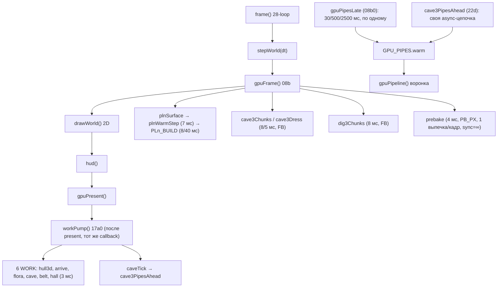

# Frame pacing — аудит систем подготовки ресурсов (2026-11-01)

Ветка `engine`, верхний коммит на момент аудита — `f2ee2ce`. Статический аудит кода + ранее снятые
трейсы (`%TEMP%\drift_trace*.json`). Игровой код в этом шаге **не менялся**.

## 1. Краткий диагноз

- **Фрагментация подготовки в коде реальна**, но её вклад в наблюдаемые 33–79 мс **не доминирует**:
  измеренный JS-кадр — 0.54 мс в среднем и 9.5 мс в худшей сцене, при этом `DrawFrame` показывает
  60 Гц против 240 Гц rAF. То есть на стенде кадр теряется **не в подготовке**, а в презентации.
- Наиболее вероятная точка скачков на стенде: **композитор/presentation** (`DrawFrame` p90 16.6 мс,
  9.3 % провалов; 2200 отрисовок на 3700 BeginFrame).
- Связь с GPU compilation кодом **заявлена** (комментарий 08b0: 58–83 мс на Android), но в наших
  трейсах `Graphics.Pipeline` p99 = 3.9 мс — на этой машине компиляция кадр не рвёт.
- **Доказано кодом:** несогласованные бюджеты (см. P1/P2), неограниченный `prebake(...,true)`,
  две независимые очереди конвейеров. **Гипотеза:** их сумма даёт скачки в переходах — требует
  инструментирования первых 0–4 с (сейчас deep-бенчмарк эти кадры пропускает, см. P0).

## 2. Архитектурная карта

Бюджеты (фактические константы):

| Система | Файл | Бюджет | Общий счёт FB? |
|---|---|---|---|
| `workPump` | `17a0-prebake.js:54` | `WORK_MS=3`, `WORK_JS=10`, `WORK_LO=.5`, `WORK_STARVE=20` | да (`fbSpend`) |
| `prebake` | `17a0-prebake.js:18` | `PB_MS=4`, `PB_PX=2^19`, `PB_CAP=64`, 1 выпечка/кадр | **нет** |
| `plnWarmStep` | `21pz-pln-frame.js:307` | `B=7` | **нет** (early return до `fbSpend`) |
| `PLN_BUILD` | `21pf-pln-land.js:38` | `ms=8, first=40, frame=5, low=1` | да (`fbLeft`) |
| `CAVE3_CH` | `22da-cave-pln-rock.js:17` | `ms=8, first=420` | да (`fbLeft`) |
| `CAVE3_DR` | `22dc-cave-pln-dress.js:10` | `ms=5, first=300` | да (`fbLeft`) |
| `DIG3_CH` | `23ca-dig-pln-rock.js:31` | `ms=8, hold=10, first=420` | да (`fbLeft`) |
| `CAVE_PRE` | `22d-cave-pln.js:116` | `wait=60, ms=3` | через `workPump` |
| `gpuPipesLate` | `08b0-gpu-pipe.js:114` | `GPU_LATE_GAP=30/PLANET=500/FLIGHT=2500` | нет (async) |
| `cave3PipesAhead` | `22d-cave-pln.js:122` | своя цепочка, без общего темпа | нет (async) |

## 2b. Переходы: кто что тянет

| Переход | Стартует синхронно (в кадре) | Тянется фоном | Что инвалидируется | Риск |
|---|---|---|---|---|
| `system → landing` | `plnLand` первый кадр (`PLN_BUILD.first=40`), `plnWarmStep` (7, до первого `fbSpend`), `cave3PipesAhead` | `gpuPipesLate` (`PLANET 500`), `prebake` (4) | `L.warm`/`L.jobs`, `PLN_FLORA.kit` если генерация сменилась | **высокий** |
| `landing → surface` | `plnLandStep` (`fbLeft`→10), `plnPlantStep`, `caveTick` (3) | `gpuPipesLate` (`PLANET 500`) | `L.flora.src` при смене `deposits` (`plnPlantRefit`) | средний |
| `surface → cave` | `caveMake` через `cavePreMake` (сетка уже посчитана `caveGridStep`), `CAVE3_CH` 8, `CAVE3_DR` 5, `caveTick` | `gpuPipesLate`, `cave3PipesAhead` | `CAVE_PRE.st`, `CAVE_DECO.defer` | **высокий** |
| `surface → dig` | `dig3Chunks` (`DIG3_CH` 8), `DIG3_TOP.hand` | `gpuPipesLate` | `DIG3.ch` | средний |
| `map → system` | `arrWarm` (`WORK` prio 1) | `gpuPipesLate` (`FLIGHT 2500`) | `BELT_ROCK` при смене системы | низкий |
| возврат/повтор | кэши (`L.warmDone`, `CAVE_PRE`, `DIG3.ch`) живы | — | — | низкий |
| холодный старт | `gpuPipesWarm` (таблица полёта), gate «Начать» | `gpuPipesLate` стартует через `setTimeout(300)` | — | средний |

Ключевое наблюдение: в `system → landing` и `surface → cave` в одном кадре сходятся
**три независимых счётчика** — `PLN_BUILD`/`CAVE3_*` (общий `FB`), `plnWarmStep` (свои 7, вне `FB`),
`prebake` (свои `PB_MS=4`, вне `FB`). Их сумма кодом не ограничена.

## 2c. Синхронные блокировки (аудит)

| Место | Что синхронно | Потолок | Достижимо на переходе |
|---|---|---|---|
| `17a0-prebake.js:32` | `while(sync\|\|…)` — генератор до `r.done` | **нет** при `sync` | да: `12ai1:29`, `17k:119`, `17l:118` |
| `08b0-gpu-pipe.js:29` | `d.createRenderPipeline(mk())` — **синхронная** компиляция в воронке | нет | да, если ключ не прогрет (сторож `91zzzzzzy5`) |
| `21pz-pln-frame.js:311` | `while(wallMs()-t0<B&&plnFloraKitStep())` | 7 мс, но шаг неделим | да, первый кадр захода |
| `22d-cave-pln.js:155` | `while(g.k<N)` — сетка `caveGridStep` | `ms` на шаг | да, `caveTick` |
| `08b0-gpu-pipe.js:131` | `while(!flat.length&&todo.length)` — разворачивание групп | нет, но только дескрипторы | низкий |
| `21pf-pln-land.js:514` | `PLN_BUILD.first=40` | 40 мс | **да, первый кадр спуска** |
| `17c2a-hull3d.js` / `hullStudio` | построение меша корпуса | нет в кадре | при смене корпуса |
| `prebake`-вызовы (hotel/billboard/neon/fleet/rack) | запись команд выпечки | `PB_MS`/`PB_PX`/1 выпечка | да, на переходах |

## 3. Подтверждённые проблемы

### P0. Deep-бенчмарк пропускает кадры перехода — `28z-fps-probe.js:347,354,364`
`g11RunDeepHere` делает `sleep(5000)`/`sleep(4000)`/`sleep(5000)` после входа в режим, то есть меряет
уже прогретое состояние. **Первые 0–4 с перехода (ровно там, где по симптомам скачки) не измеряются
вовсе.** Уверенность — высокая (код). Проверка: добавить режим `?g11=near` без пауз.

### P1. Бюджет `plnWarmStep` не входит в общий счёт кадра — `21pz-pln-frame.js:360`
`if(fly&&o.warm&&…&&plnWarmStep(L,S,p,C,V))return "warm";` — ранний выход **до** `fbSpend(...)` (строка
367). Значит 7 мс захода не уменьшают `fbLeft` для `plnLandStep/plnPlantStep/workPump` в том же кадре.
Сумма: заход 7 + `workPump` 3 + `prebake` 4 = **до 14 мс**, а `FB` об этом не знает. Уверенность —
высокая (код). Проверка: `WORK_MAX`/`PB_MAX` + `FRAME_JS` на переходах.

### P2. `prebake(...,sync=true)` не ограничен ни `PB_MS`, ни `PB_PX`, ни `PB_CAP` — `17a0-prebake.js:32`
`while(sync||PB_N<PB_CAP&&…)` — при `sync` цикл идёт до `r.done`, то есть генератор шагает **целиком**
в текущем callback. Вызовы с `sync`: `12ai1-fleet-art.js:29` (`!ahead`), `17k-billboard.js:119`,
`17l-hotel.js:118` (`sync&&!same`). Комментарий прямо говорит «вещь уже на экране» — значит на переходах
(выход из дока, загрузка, резкий поворот) это достижимо. Уверенность — средняя (зависит от размера
генератора). Проверка: `PB_MAX[key]` в этих точках.

### P3. Две независимые очереди компиляции — `08b0-gpu-pipe.js:122` и `22d-cave-pln.js:122`
`gpuPipesLate` (по одному ключу, свой темп по `G.mode`) и `cave3PipesAhead` (своя цепочка
`createRenderPipelineAsync`, зовётся из `plnWarmStep:305` и `caveTick:190`) дедуплицируют ключи через
общую `GPU_PIPES.warm`, но **темпа друг о друге не знают** и могут компилировать одновременно. На
Android это главный поток процесса ГПУ (комментарий 08b0: кадры 58–83 мс). На этой машине в трейсах
`Graphics.Pipeline` p99 3.9 мс — вклад не виден. Уверенность — средняя.

### P3. `stallWho()` называет остаток «gpu» — `28-loop.js:127`
`gpu: Math.max(0, gap - Math.max(lt, FRAME_JS))` — это остаток (растр/композитор), не GPU; комментарий
это признаёт, но имя поля путает. Проверка: переименовать в `rest` (или `comp`).

### P3. `smooth`-путь даёт 40 мс первому кадру захода — `21pf-pln-land.js:38`, `21pz-pln-frame.js:359`
`PLN_BUILD.first=40` — первый кадр спуска намеренно получает 40 мс (принятый рывок). Это бюджет, а не
баг, но в отчётах он не отделён от настоящих скачков.

### Что проверено и НЕ подтвердилось
- «Все сцены крутят свои циклы» — нет: `frame()` один, `drawWorldIn` — взаимоисключающая цепочка.
- «GPU виноват» — нет: `Graphics.Pipeline` p99 3.9 мс, `fp` < 0.2 мс на проход.
- «`--disable-gpu-compositing` лечит» — нет: это 60 Гц по построению.

## 4. Недостающие измерения

- **Per-frame breakdown перехода**: нет раздельных замеров `stepWorld` / конкретного `draw*` /
  `gpuFrame` / `gpuPresent` / `workPump` / `plnWarmStep` в одном кадре. `FRAME_JS` — только сумма.
- **`WORK`-активность**: `WORK_T` и `WORK_MAX` считаются, но в `?g11` не выводятся; какая задача
  сколько взяла в кадре — не видно.
- **Pipeline compile**: `GPU_PIPES.late.{n,ms,done}` и `CAVE3_AHEAD` есть, но момент компиляции и её
  длительность не попадают в per-frame метрики.
- **Presented-кадры**: `DrawFrame` виден только в trace, не в `?g11`; `stallWho`-«gpu» остаток не
  заменяет.
- **Окно 0–4 с**: deep-бенчмарк его пропускает (P0).
- **Обычное окно**: трейс окна не снимался (только rAF-цифры) — presented вне headless не доказан.

## 4a. Аудит диагностики — что реально меряют счётчики

| Метрика | Где | Что меряет | Чего не видит |
|---|---|---|---|
| `FRAME_JS` | `28-loop.js:119,730` | `wallMs()` вокруг `frameBody` | не делит на `stepWorld`/`draw*`/`gpuFrame`/`gpuPresent`/`workPump` |
| `LONGTASKS` | `28-loop.js:119–121` | `PerformanceObserver` «longtask» (`startTime`, `duration`, буфер 40) | только задачи > 50 мс; не привязан к режиму/переходу |
| `stallWho.gap` | `28-loop.js:127` | интервал между rAF (`b-a`) | — |
| `stallWho.js` | `28-loop.js:127` | `FRAME_JS` | — |
| `stallWho.lt` | `28-loop.js:124–126` | сумма longtask, попавших в интервал | задачи < 50 мс не видит |
| **`stallWho.gpu`** | `28-loop.js:127` | **остаток** `gap − max(lt, FRAME_JS)` | это растр/композитор, **не GPU**; имя поля путает |
| `stallWho.bake` | `28-loop.js:125` | только `MAT_JOB` («mat») | остальные выпечки |
| `WORK_T` | `17a0:77` | длительность `workPump` целиком | разбивки по задачам нет |
| `WORK_MAX[name]` | `17a0:75` | самый долгий ход работника | — |
| `GPU.bakeN` | `08ca` (ворота `PB_*`) | число выпечек в кадре | длительность каждой — только `PB_MAX` |
| `PB_MAX[key]` | `17a0:35` | самый долгий шаг `prebake` | — |
| `GPU_PIPES.late{n,ms,done,bad}` | `08b0:123` | счётчик и длительность поздних конвейеров | момент каждого |
| `CAVE3_AHEAD{dev,ms}` | `22d:121` | факт запуска очереди пещеры | прогресс/остаток |
| `PLN_BUILD` | `21pf:38` | константы бюджета (8/40/5) | — |
| `FRAME_GAP` | — | **под этим именем не существует** — это `stallWho.gap` | — |
| `LONG_TASK` | — | **под этим именем не существует** — это `LONGTASKS` | — |

Вывод: остаток (`stallWho.gpu`) действительно выдаётся за «GPU» — это уже зафиксировано как P3;
остальные счётчики честные, но **не per-frame** и не привязаны к переходу, поэтому 0–4 с перехода
ими не разложить.

## 5. План исправления (минимальный, по порядку)

1. **P0 — сначала измерение**: `?g11=near` без пауз, 240 кадров после входа, per-frame breakdown
   (`FRAME_JS`, `stepWorld`, `gpuFrame`, `workPump`, `plnWarmStep`, `PB_MAX`, `WORK_MAX`).
   Ожидаемо: увидеть, есть ли реальный скачок в 0–4 с и кто его съел. Риск — нулевой (диагностика).
2. **P1 — включить `plnWarmStep` в `FB`**: в конце warm-ветки вызвать `fbSpend(работа)`.
   Ожидаемо: `workPump`/`prebake` перестанут добавляться сверх 10 мс. Риск: заход станет на кадр
   длиннее; проверка — `?g11=near`.
3. **P2 — ограничить `sync` у `prebake`**: либо `PB_CAP`-подобный потолок и на `sync`, либо
   отложить sync-выпечки на кадр после перехода. Риск: кратковременная «пустота» там, где раньше
   дорисовывалось в кадре; проверка — вижн + глазами.
4. **P3 — общий темп двух очередей**: `cave3PipesAhead` спрашивает `gpuLateGap()` (или общий
   `PIPES.next`), чтобы не компилировать в один квант. Риск: пещера соберётся чуть позже.
5. **P3 — переименовать `stallWho.gpu` → `rest`** и вывести `WORK_T`/`WORK_MAX` в `?g11`.

## 6. Конкретный технический план

| # | Файл | Что менять | Зачем | Проверка |
|---|---|---|---|---|
| 1 | `src/28z-fps-probe.js` | режим `?g11=near`, без `sleep`, 240 кадров, per-frame поля | P0 | `test.ps1`, `docs/g11.ps1` |
| 2 | `src/21pz-pln-frame.js:360` | `fbSpend` на warm-ветке | P1 | `WORK_MAX`/`FRAME_JS` |
| 3 | `src/17a0-prebake.js:32` | потолок на `sync` | P2 | `PB_MAX` |
| 4 | `src/22d-cave-pln.js:122` | `cave3PipesAhead` берёт темп у `gpuLateGap` | P3 | `CAVE3_AHEAD`/`GPU_PIPES.late` |
| 5 | `src/28-loop.js:127` | `gpu`→`rest` | P3 | `stallWho` в журнале |
